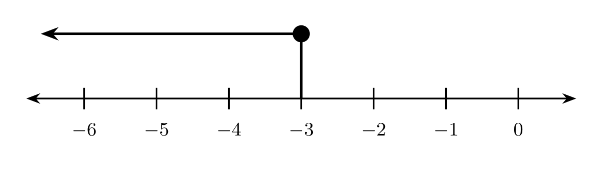
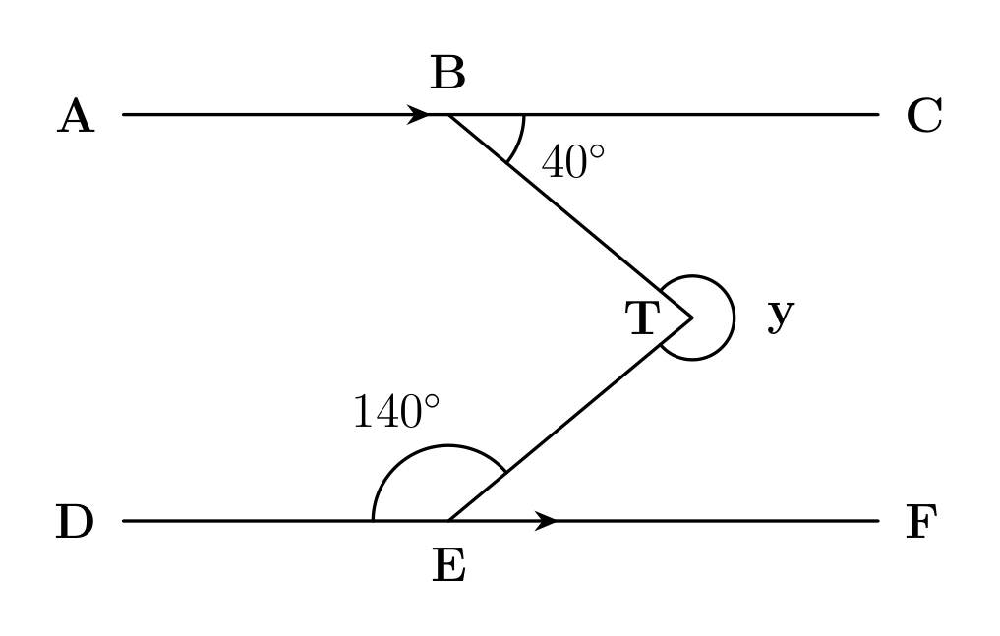
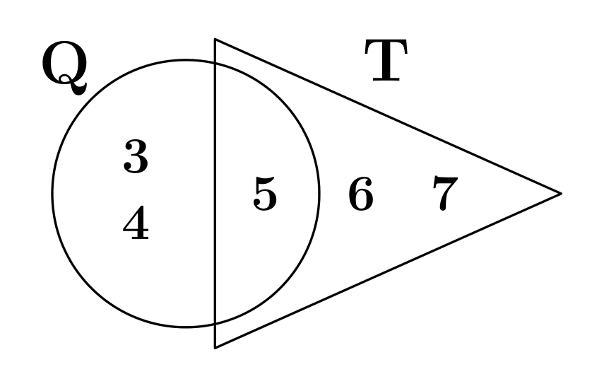
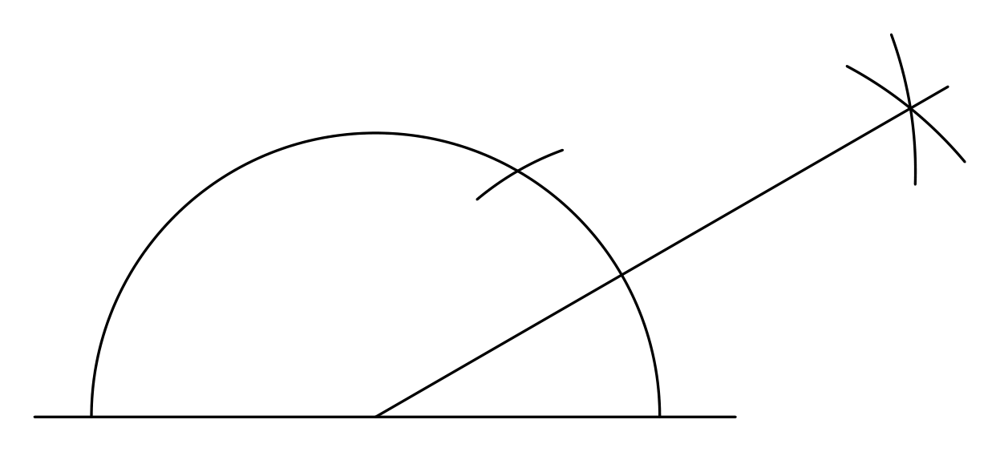
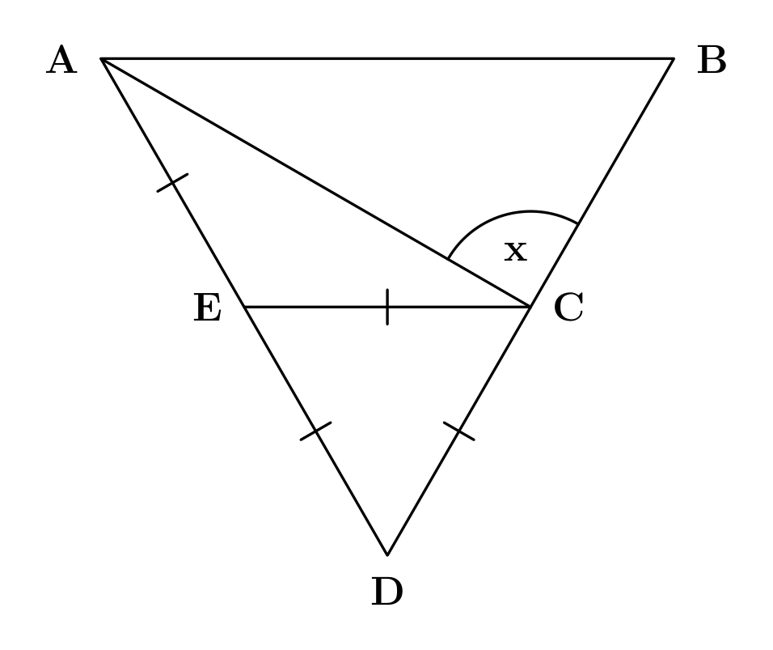
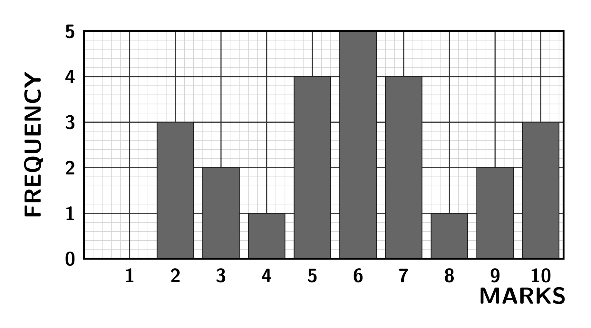

# STARALEX EDUCATIONAL COMPLEX
## BASIC EDUCATION CERTIFICATE EXAMINATION (BECE)
### MATHEMATICS — MOCK EXAMINATION SAMPLE PAPER
**Time Allowed:** 1 Hour | **Paper 1 (Objective Test)**

---

### INSTRUCTIONS TO CANDIDATES
1. Use a soft pencil (type B or 2B) for answering all questions.
2. Read each question carefully before choosing your answer.
3. Each question is followed by four options lettered **A** to **D**. Find the correct option for each question and record your choice clearly.
4. All rough work must be done on scratch paper and not on this question paper.

---

### SECTION A: OBJECTIVE DRILLS

**1.** The number line below shows a mathematical solution set. Which of the following inequalities is represented by the diagram? *(see Figure 1)*

A. x < −3  
B. x ≤ −3  
C. x > −3  
D. x ≥ −3  

<!-- pagebreak -->

**2.** In the diagram below, MNO is a right-angled triangle where |MO| = 13 cm and |MN| = 5 cm. What is the value of x? *(see Figure 2)*

A. 3 cm  
B. 4 cm  
C. 8 cm  
D. 12 cm  

---

**3.** In the diagram below, line AC is parallel to line DF (AC // DF). Angle CBT is 40° and angle DET is 140°. Find the value of the reflex angle marked y. *(see Figure 3)*

A. 320°  
B. 280°  
C. 220°  
D. 100°  

<!-- pagebreak -->

**4.** In the diagram below, O is the centre of the circle and r is its radius. Calculate the area of the shaded minor sector. *(see Figure 4)*

A. ⅙ πr²  
B. ⅕ πr²  
C. ⅓ πr²  
D. ⅚ πr²  

---

**5.** In the diagram below, Q is the set of numbers inside the circle and T is the set of numbers inside the triangle. Determine the union set Q ∪ T. *(see Figure 5)*

A. {5}  
B. {6, 7}  
C. {3, 4, 5}  
D. {3, 4, 5, 6, 7}  

<!-- pagebreak -->

**6.** Which of the following statements best describes the compass and straightedge construction shown in the diagram below? *(see Figure 6)*

A. Constructing 30°  
B. Constructing 60°  
C. Constructing 120°  
D. Constructing 135°  

---

**7.** In the diagram below, |AE| = |ED| = |DC| = |CE|. Calculate the size of the angle marked x. *(see Figure 7)*

A. 120°  
B. 90°  
C. 60°  
D. 30°  

<!-- pagebreak -->

**8.** The frequency bar chart below shows the distribution of marks scored by pupils in a mathematics test. How many pupils took the test? *(see Figure 8)*

A. 20 pupils  
B. 25 pupils  
C. 30 pupils  
D. 35 pupils  

<!-- pagebreak -->

### SECTION B: MODEL MARKING SCHEME & STEP-BY-STEP SOLUTIONS

#### Question 1
- **Answer:** **B — x ≤ −3**
- **Working & Reason:** The arrow originates at −3 and points to the left towards smaller negative values, indicating a "less than" relation. The solid circle at −3 confirms that −3 is included in the solution set (≤). Thus, the inequality is x ≤ −3.

#### Question 2
- **Answer:** **D — 12 cm**
- **Working & Reason:** By Pythagoras theorem in right-angled triangle MNO:  
  |MO|² = |MN|² + |NO|²  
  13² = 5² + x²  
  169 = 25 + x²  
  x² = 169 − 25 = 144  
  x = √144 = 12 cm.

#### Question 3
- **Answer:** **B — 280°**
- **Working & Reason:** Draw an auxiliary line through T parallel to AC and DF.  
  Upper alternate angle = ∠CBT = 40°.  
  Lower alternate angle = 180° − ∠DET = 180° − 140° = 40°.  
  Total interior angle ∠BTE = 40° + 40° = 80°.  
  Reflex angle y = 360° − 80° = 280°.

#### Question 4
- **Answer:** **A — ⅙ πr²**
- **Working & Reason:** The area of a circle sector is given by:  
  Area = (θ / 360°) × πr²  
  Here θ = 60°.  
  Area = (60° / 360°) × πr² = ⅙ πr².

<!-- pagebreak -->

#### Question 5
- **Answer:** **D — {3, 4, 5, 6, 7}**
- **Working & Reason:** Set Q contains all elements in the circle: Q = {3, 4, 5}.  
  Set T contains all elements in the triangle: T = {5, 6, 7}.  
  The union Q ∪ T combines all unique elements from both sets:  
  Q ∪ T = {3, 4, 5, 6, 7}.

#### Question 6
- **Answer:** **A — Constructing 30°**
- **Working & Reason:** The construction first establishes a 60° arc intersection using equal compass radii from the baseline. Next, equal arcs are struck from the baseline intersection and the 60° mark to bisect the 60° angle. A ray drawn through this bisection yields half of 60°, which is exactly 30°.

#### Question 7
- **Answer:** **B — 90°**
- **Working & Reason:** Since |ED| = |DC| = |CE|, triangle EDC is equilateral, so all its angles are 60°.  
  On straight line AED, ∠AEC = 180° − 60° = 120°.  
  Triangle AEC is isosceles (|AE| = |CE|), so base angles are (180° − 120°) / 2 = 30°.  
  On straight line BCD, ∠ACB + ∠ECA + ∠ECD = 180°.  
  x + 30° + 60° = 180°  
  x = 180° − 90° = 90°.

#### Question 8
- **Answer:** **B — 25 pupils**
- **Working & Reason:** Sum the frequencies (heights) of each score column:  
  Total pupils = 3 (for mark 2) + 2 (mark 3) + 1 (mark 4) + 4 (mark 5) + 5 (mark 6) + 4 (mark 7) + 1 (mark 8) + 2 (mark 9) + 3 (mark 10)  
  Total = 3 + 2 + 1 + 4 + 5 + 4 + 1 + 2 + 3 = 25 pupils.
